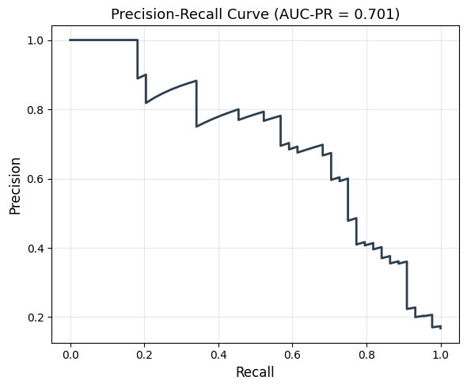
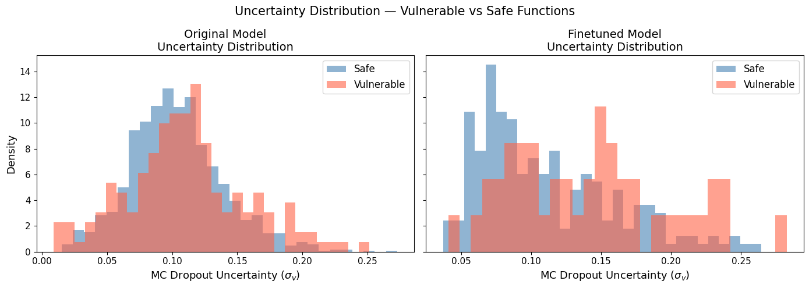
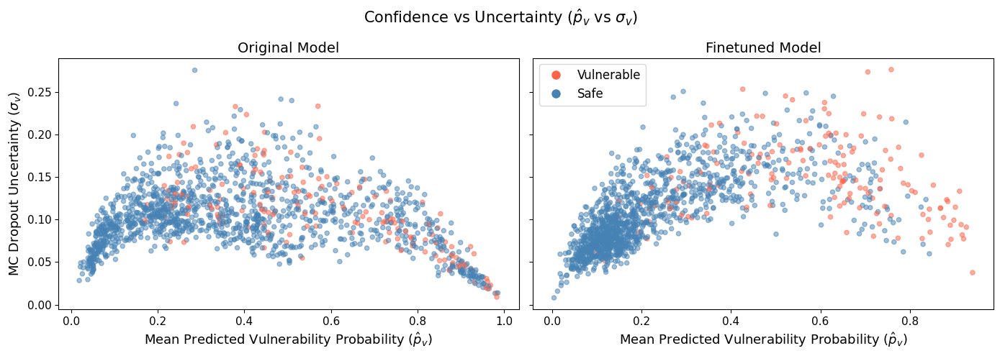
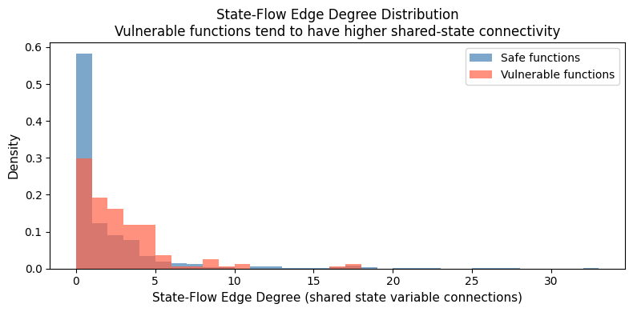
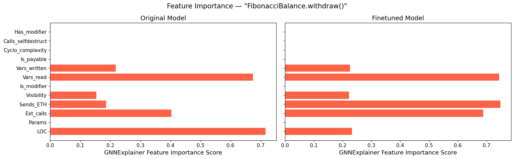
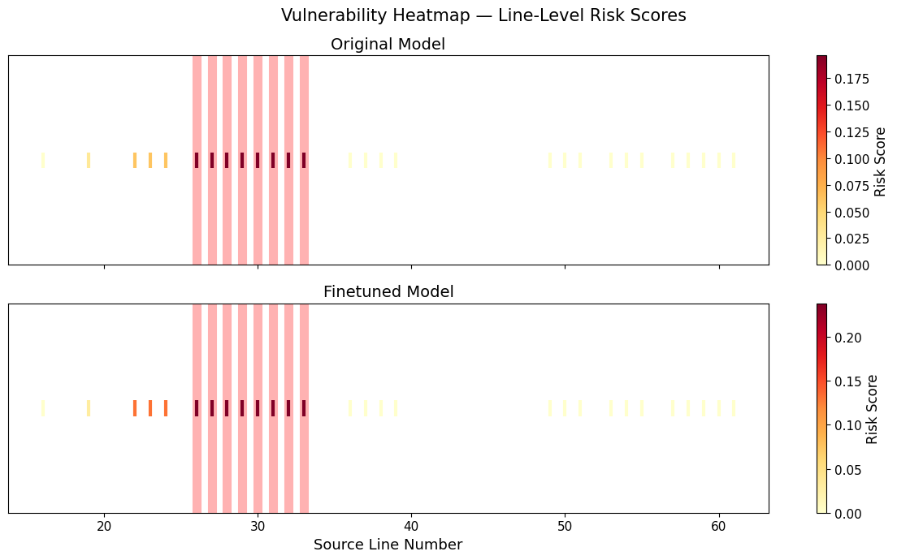
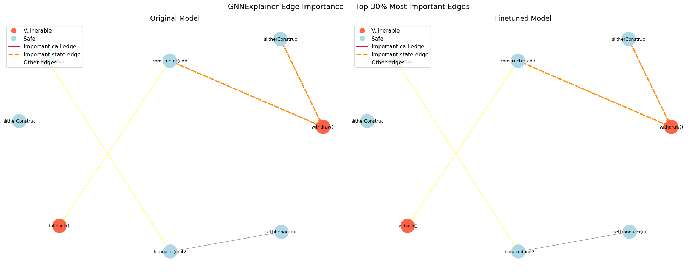

# Graph-Based Smart Contract Vulnerability Detection

[](https://www.iccisconf.com/)
[](https://www.python.org/)
[](https://pytorch.org/)
[](https://pytorch-geometric.readthedocs.io/)

Official implementation of our research work, **GNN-Based Function-Level Vulnerability Detection in Smart Contracts**, accepted and presented at the **8th International Conference on Communication and Intelligent Systems (ICCIS 2026)**.

**Authors:** Smruthi B.S., Subashri V., Bhaskarjyoti Das

---

## Overview

Smart contracts are self-executing programs deployed on blockchain networks. However, vulnerabilities in their implementation can expose decentralized applications to significant security risks and financial losses.

Traditional smart contract vulnerability detection approaches often rely on static analysis tools and predefined vulnerability patterns. While useful, these approaches may struggle to capture complex relationships and dependencies between different functions within a contract.

This project explores a **Graph Neural Network (GNN)-based approach to smart contract vulnerability detection** by representing Solidity functions as program graphs.

The proposed framework captures two types of relationships:

- **Function-call edges:** Represent interactions and invocation relationships between functions.
- **State-flow edges:** Represent dependencies between functions through shared state variables.

These graph representations are used to train Graph Neural Networks, particularly GraphSAGE, to identify vulnerable functions.

The framework additionally incorporates uncertainty estimation and explainability techniques to provide insights into model predictions and the structural components contributing to vulnerability detection.

## Key Contributions

- **Graph-Based Representation:** Converts Solidity smart contracts into program graphs using function-level representations.
- **Heterogeneous Relationships:** Integrates function-call and state-flow edges to capture structural and data dependencies.
- **Graph Neural Networks:** Implements Graph Convolutional Networks (GCN) and GraphSAGE for vulnerability classification.
- **Class Imbalance Handling:** Uses focal loss and class-weighted training to address imbalanced vulnerability labels.
- **Hard-Negative Fine-Tuning:** Incorporates hard-negative examples to improve classification performance.
- **Uncertainty Estimation:** Implements Monte Carlo Dropout (MC Dropout) to estimate predictive uncertainty.
- **Explainable AI:** Uses GNNExplainer to identify influential node features and graph edges.
- **Source-Code Attribution:** Generates source-line heatmaps to visualize the relationship between model explanations and Solidity code.
- **Experimental Evaluation:** Includes multi-seed experiments, ablation studies, baseline comparisons, and statistical analysis.

## Methodology

The proposed framework consists of the following stages.

### 1. Solidity Parsing and Feature Extraction

Smart contracts are analyzed using Slither to extract function-level information and structural properties.

Each function is represented using 12 engineered features:

| Feature | Description |
|---|---|
| LOC | Number of control-flow graph nodes in the function |
| Parameters | Number of function parameters |
| External Calls | Number of external calls |
| Sends ETH | Whether the function sends Ether |
| Visibility | Whether the function is public |
| Is Modifier | Modifier indicator |
| State Variables Read | Number of state variables accessed |
| State Variables Written | Number of state variables modified |
| Is Payable | Whether the function is payable |
| Cyclomatic Complexity | Approximation based on branching and loop nodes |
| Self-Destruct | Whether the function invokes self-destruct |
| Has Modifier | Whether the function uses modifiers |

### 2. Graph Construction

Each smart contract is represented as a graph where nodes correspond to individual Solidity functions.

Two types of edges are constructed:

- **Call Edges:** Capture relationships between functions based on function invocations.
- **State-Flow Edges:** Capture dependencies between functions based on shared state-variable access, connecting functions that write to and read from the same state variables.

The resulting graphs are converted into PyTorch Geometric data structures.

Each graph contains:
- Node feature matrix.
- Combined edge index.
- Edge-type information distinguishing call and state-flow relationships.
- Function-level vulnerability labels.
- Function names and source-line mappings for explainability.

### 3. Graph Neural Network Architecture

Two graph neural network architectures are implemented and evaluated:

- Graph Convolutional Network (GCN)
- GraphSAGE

Both architectures use three graph convolution layers with batch normalization, ReLU activations, and dropout.

The final model configuration uses GraphSAGE to learn function representations by aggregating information from neighboring nodes.

### 4. Training and Optimization

The training pipeline incorporates:

- **Focal Loss:** Addresses class imbalance by assigning greater importance to difficult classification examples.
- **Class Weighting:** Increases the contribution of vulnerable samples during training.
- **Early Stopping:** Monitors validation loss to prevent unnecessary training.
- **Learning-Rate Scheduling:** Uses ReduceLROnPlateau to adjust the learning rate.
- **Hard-Negative Fine-Tuning:** Further trains the selected GraphSAGE model using a hard-negative training pool.

The final GraphSAGE configuration uses focal loss with gamma = 3.0 and a vulnerable-class weight of 12.0.

### 5. Uncertainty Estimation

Monte Carlo Dropout is used to estimate predictive uncertainty.

Multiple stochastic forward passes are performed with dropout enabled during inference.

The mean prediction probabilities are used to obtain the final predictions, while the standard deviation of vulnerability-class probabilities provides an estimate of predictive uncertainty.

The implementation uses 30 stochastic forward passes by default.

### 6. Explainability

GNNExplainer is integrated to investigate the model's predictions.

The framework generates:

- Node feature importance scores.
- Edge importance scores.
- Source-code line attribution heatmaps.
- Graph visualizations highlighting influential relationships.

These explanations help identify which function characteristics and structural dependencies contribute to vulnerability predictions.

## Dataset

The project uses the following SmartBugs datasets:

| Dataset | Purpose | Size |
|---|---|---:|
| SmartBugs Wild | Training and graph construction | 8,111 parsed graphs |
| SmartBugs Curated | Held-out benchmark evaluation | 121 graphs |

The datasets are processed to extract Solidity functions, construct graph representations, and generate vulnerability labels.

The SmartBugs Wild dataset uses pseudo-labels, while the Curated benchmark provides the evaluation data.

Dataset preparation and preprocessing are implemented within the research notebook.

## Experimental Results

### Model Performance

The proposed approach achieves a reported five-seed average F1-score of:

**0.605 ± 0.115**

The reported Slither baseline F1-score is 0.500 on the full Curated benchmark set.

### Ablation Study

An ablation study investigates the contribution of state-flow edges to graph representation learning.

Integrating state-flow edges alongside function-call edges produces a **+0.027 improvement in F1-score** compared with using function-call edges alone.

This demonstrates the value of incorporating state-variable dependencies when modeling smart contract behavior.

### Evaluation Protocol

The notebook includes multiple evaluation settings:

- Zero-shot evaluation on the full 121-graph Curated benchmark.
- Evaluation on a held-out 30% Curated split (37 graphs).
- Before-and-after comparisons for hard-negative fine-tuning.
- Deterministic and MC Dropout-based predictions.

The fine-tuned model is evaluated on the held-out Curated split, as the remaining Curated training graphs are incorporated into the fine-tuning pool.

### Visualizations

The following figures are generated by the research notebook and illustrate different aspects of model performance and explainability.

#### 1. Precision-Recall Curve



#### 2. Uncertainty Estimation



#### 3. Prediction Confidence



#### 4. State-Flow Graph Analysis



#### 5. Feature Importance



#### 6. Source-Code Line Attribution



#### 7. Graph Edge Importance



## Repository Structure

```text
smart-contract-vuln-detection/
│
├── GRAPHite_vuln_detection.ipynb
│   # Complete research implementation
│   # Solidity parsing and feature extraction
│   # Graph construction and dataset preprocessing
│   # GCN and GraphSAGE model definitions
│   # Training, focal loss and hard-negative fine-tuning
│   # MC Dropout uncertainty estimation
│   # Model evaluation and ablation studies
│   # GNNExplainer and result visualization
│
├── paper/
│   └── ICCIS_2026_Paper.pdf    
│
├── results/
│   ├── auc_pr_curve.png
│   ├── uncertainty_histogram.png
│   ├── confidence_scatter.png
│   ├── state_flow_degree.png
│   ├── feature_importance.png
│   ├── line_heatmap.png
│   └── edge_importance_graph.png
│
├── requirements.txt
│
└── README.md
```

## Installation and Usage

### 1. Clone the Repository

```bash
git clone https://github.com/smruthi-bs/smart-contract-vuln-detection.git

cd smart-contract-vuln-detection
```

### 2. Install Dependencies

```bash
pip install -r requirements.txt
```

For GPU execution, ensure that the installed PyTorch and PyTorch Geometric versions are compatible with your CUDA environment.

### 3. Install Solidity Compiler

The notebook uses Solidity compiler versions 0.4.22 and 0.4.25.

Install the required compiler versions using:

```bash
solc-select install 0.4.22
solc-select install 0.4.25
```

The notebook also uses `py-solc-x` to install and manage compiler versions programmatically.

### 4. Open the Research Notebook

Launch Jupyter Notebook:

```bash
jupyter notebook
```

Open:

```text
GRAPHite_vuln_detection.ipynb
```

Alternatively, the notebook can be uploaded and executed in Google Colab.

### 5. Run the Implementation

Execute the notebook cells sequentially.

The notebook contains the complete implementation, including:

1. Dataset preparation and downloading.
2. Solidity parsing and feature extraction.
3. Graph construction and preprocessing.
4. GCN and GraphSAGE model definitions.
5. Model training and evaluation.
6. Focal loss and hard-negative fine-tuning.
7. MC Dropout uncertainty estimation.
8. Ablation studies and statistical analysis.
9. GNNExplainer integration and visualization.

**Note:** Dataset preparation can involve long-running operations, particularly pseudo-label generation and graph construction. Preprocessed dataset files can be used to skip these steps when available.

## Technologies Used

| Category | Technologies |
|---|---|
| Programming Language | Python |
| Smart Contract Analysis | Solidity, Slither |
| Deep Learning | PyTorch |
| Graph Learning | PyTorch Geometric |
| Graph Architectures | GCN, GraphSAGE |
| Optimization | Focal Loss, Class Weighting, Hard-Negative Fine-Tuning |
| Explainable AI | GNNExplainer |
| Uncertainty Estimation | Monte Carlo Dropout |
| Evaluation | Scikit-learn, SciPy |
| Visualization | Matplotlib, Seaborn, NetworkX |

## Research Presentation & Publication

This research work was accepted and presented at the **8th International Conference on Communication and Intelligent Systems (ICCIS 2026)**.

**Authors:**
- Smruthi B.S.
- Subashri V.
- Bhaskarjyoti Das

### Publication Details

The conference proceedings are scheduled to be published in **Springer's Lecture Notes in Networks and Systems (LNNS)** book series, which is indexed in Scopus.

- **Conference:** 8th International Conference on Communication and Intelligent Systems (ICCIS 2026)
- **Presentation Status:** Accepted and Presented
- **Publication Series:** Springer Lecture Notes in Networks and Systems (LNNS)
- **Publication Status:** Forthcoming

### Presented Paper

The accepted and presented version of the research paper is available in the paper/ directory.

The final published version and official citation details will be updated once the conference proceedings are released.
## Acknowledgements

We acknowledge the SmartBugs benchmark datasets and the open-source tools and libraries that supported the development and evaluation of this research.

---

**Research Areas:** Smart Contract Security | Blockchain | Graph Neural Networks | Deep Learning | Explainable AI